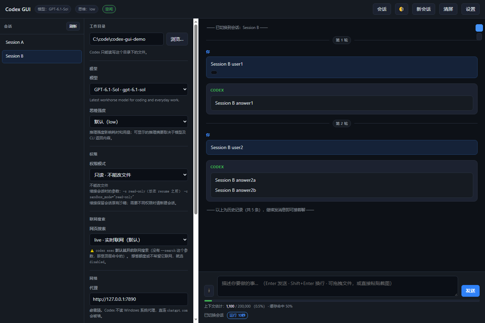

# Codex GUI

[English](README.md) · **简体中文**

把 [Codex CLI](https://github.com/openai/codex) 包一层本地网页界面 —— 不需要装官方桌面端。



## 为什么有这个项目

官方 Codex 桌面端不是每台机器都能装。我的情况是工作笔记本跑 Windows 10 build
18363，安装程序不支持；而长时间用纯命令行很难受：翻不回去、老会话不好重开、
贴附件也麻烦。

所以这是在**你已经有的 CLI** 上套一层薄的本地网页界面。它不重新实现模型、不代理你的流量、也不往外发任何东西。它起一个 `codex exec --json` 进程，读 JSONL，渲染出来。

**如果你的系统装得上官方桌面端，请用官方桌面端** —— 它更好。这个项目是给那些「掉在缝里」的机器用的。

## 功能

- **和 Codex CLI 对话** —— Enter 发送、Shift+Enter 换行、中文输入法选词不会误发
- **会话列表** —— 继续、重命名、删除历史会话，历史从磁盘回放
- **模型与思维强度下拉框** —— 数据来自 CLI 自己的目录
- **权限模式** —— 只读 / 工作区可写 / 完全放开，可按会话切换
- **附件** —— 图片作为图片输入，其它文件通过路径交给 Codex
- **工具活动折叠卡片** —— 命令、退出码、联网搜索按轮分组
- **文件改动是独立卡片** —— 彩色 unified diff，摘要上带 `+N −N`，自动展开，**不放在工具组里**，所以折叠工具不会把它藏起来
- **页内文件查看器** —— `file.c:236` 这类引用点开是右侧面板，带行号并定位到该行，markdown 直接渲染；不主动交给外部编辑器
- **上下文仪表** —— 窗口占用情况，以及推断出的「可能已压缩」标记
- **原生目录选择器**、三套主题、无窗口后台启动
- **零运行时依赖** —— 只用 Node 内置模块，不需要 `npm install`

## 环境要求

- Node.js **22+**
- 已安装并登录的 Codex CLI（`codex` 在 `PATH` 里，或设置 `CODEX_GUI_CODEX_PATH`）
- 主要目标是 Windows。macOS / Linux 应该能用，但启动脚本（`.cmd` / `.vbs` / 快捷方式）是 Windows 专用的。

## 快速开始

```powershell
node launch.cjs
```

会在 <http://127.0.0.1:8790> 起服务并打开浏览器。**只监听 `127.0.0.1`。**

### 后台运行（Windows）

```powershell
powershell -NoProfile -ExecutionPolicy Bypass -File setup-shortcut.ps1
```

双击桌面 **Codex GUI**。它**完全不出现窗口**并且脱离控制台运行，所以关任何窗口都停不掉它。停止请用 **Codex GUI (stop)** 快捷方式，或：

```powershell
cmd /c "stop-codex-gui.cmd --no-pause"
```

它会报告停掉了什么、释放了哪个端口。**它不会误杀「碰巧占着端口」的进程** —— 必须确认那个进程真的是 `bridge.cjs`。

**页面会以正常窗口打开，然后被调到前台。** 两个细节都重要：后台进程创建的窗口可能是**隐藏的**（启动器自己的窗口样式会被它 spawn 的东西继承），而即使可见，后台进程也拿不到焦点 —— Windows 不允许抢焦点。两种情况看起来都是"双击完全没反应"。

**如果双击真的没反应**，看 `.codex-gui/launch.log`。`wscript` 没有控制台，所以启动器
会把每次尝试都写进去：找到哪个 node、服务是否已在运行、服务何时就绪、窗口有没有被聚焦。

### 前台运行

`start-codex-gui.cmd`（或 `node launch.cjs`）会把服务和控制台绑在一起：关窗口就停，日志直接打在屏幕上。**出问题时用这个模式。**

## 配置

设置存在代码旁边的 `settings.json`（第一次保存时创建）。可复制 `settings.example.json` 起步。它被 git 忽略，因为里面有你的工作目录和代理。

| 环境变量 | 用途 |
|---|---|
| `CODEX_GUI_PORT` | HTTP 端口，默认 `8790` |
| `CODEX_GUI_NO_BROWSER=1` | 启动时不打开浏览器 |
| `CODEX_GUI_CODEX_PATH` | 指定 Codex 可执行文件或 `codex.js` |
| `CODEX_GUI_SETTINGS_FILE` | 使用其它设置文件（测试用） |
| `CODEX_GUI_DETACH=1` | 等同 `launch.cjs --detach` |
| `CODEX_HOME` | 使用 Codex 自己的配置/认证/会话目录 |

### 权限模式

| 选项 | 行为 |
|---|---|
| 只读 | `-s read-only` |
| 工作区可写 | `--approve-for-me` —— 只能改工作目录，越界自动审查 |
| 完全放开 | `-s danger-full-access` —— 无沙箱 |

续接会话时会保留创建时的沙箱，CLI 不允许后来放大权限。界面会恢复原模式，服务端也会拒绝不匹配的续接请求 —— 所以**建会话时就要选好**。

### 代理

代理字段只会作为 `HTTPS_PROXY` / `HTTP_PROXY` 注入到 **Codex 子进程**。**绝不会写入 Windows 系统代理设置。** 留空则原样继承环境变量。

## 工作原理

```
浏览器  ──HTTP/SSE──▶  bridge.cjs  ──spawn──▶  codex exec --json
                           │                        │
                           │◀─── JSONL 事件 ────────┘
                           │
                           └──▶ app-server（stdio）──▶ 会话列表 / 重命名 / 删除
```

- 每轮对话起一个 `codex exec --json` 进程，事件通过 SSE 实时转发
- 会话元数据走**私有 stdio app-server**，因为光看 rollout 文件无法重命名或删除会话
- 历史从 `~/.codex/sessions/**/*.jsonl` 回放，包含命令执行、推理条目、联网搜索和文件改动

## 已知限制

这些是 **CLI 的性质，不是 bug**。写在这里，免得你去找一个不存在的开关：

- **没有逐字流式输出。** `codex exec --json` 是回合制的，只发整条消息的
  `item.completed`，从不发 delta。真正的流式只存在于 app-server 协议，而本项目
  **刻意避开**它（见下条）。所以回复会在回合结束时一次性出现。
- **推理摘要是空的。** 目录里所有模型都是 `default_reasoning_summary = "none"`，
  所以 Reasoning 条目带的是空的 `summary_text` 和 `raw_content`（对真实会话验证过：
  102 个条目全空）。界面因此**故意不提供**推理开关。
- **上下文用量只在回合结束时更新**，同样因为 `usage` 只在 `turn.completed` 出现一次。
  回合进行中仪表会显示「上一轮」，而不是假装实时。
- **不用 app-server 执行对话。** 调用 `thread/resume` 或 `thread/read` 会拿到线程写锁
  且**不释放**，导致之后的 `codex exec resume` 报 `thread-store conflict`，**会话就废了**。
  本项目只用只读的元数据调用。
- **压缩是推断的，不是上报的。** `codex exec --json` 没有压缩事件，界面只能把上下文
  用量的大幅回落标记为「可能已压缩」。
- **实时的文件改动事件不带 diff，但卡片会在回合结束时补上。** 实时事件只给
  `changes: [{ path, kind }]`，而 `unified_diff` 是另外写进 rollout 文件的。所以回合
  进行中你看到的是**改了哪些文件**；回合结束时桥接会从 rollout 里读出 diff，随
  `turn.completed` 一起发下来，卡片就地补全，不用刷新。这是事件的固有性质，
  已用真实回合验证过。

## 已知缺口 —— 适合作为第一个贡献

这个项目是几天内为一个人的工作流写的，**确实有洞**。如果你想拿它当 baseline，以下是按价值排序的诚实起点：

| 缺口 | 位置 | 为什么重要 |
|---|---|---|
| **会话不能搜索/过滤** | `index.html` 会话列表 | 会话到 50 个就只能翻。 |
| **不能导出** | — | 没法把整个对话导出成 Markdown。 |
| **没有并排 diff 视图** | `index.html`（`diffNode`） | diff 是统一格式纯文本，没有分栏、没有语法高亮。 |
| **多标签页没协调** | `bridge.cjs` | 同一会话两个标签页会打架；有 409 保护但没有共享状态。 |
| **快捷键太少** | `index.html` | 只有 Enter / Shift+Enter / Escape。 |
| **模型目录是静态的** | `models.json`、`extract-models.cjs` | CLI 出新模型时要手动跑 `node extract-models.cjs`。 |
| **没有 mac/Linux 启动脚本** | — | `launch.cjs` 能用，`.cmd` / `.vbs` / 快捷方式不能。 |
| **没有费用汇总** | — | 显示了每轮 token，但没有跨会话合计。 |

**唯一会毁掉会话的操作**：为了拿流式去调 `thread/resume` / `thread/read`。动手前请读上面的限制。代码地图、测试门槛、以及已经踩过的坑见 [CONTRIBUTING.md](CONTRIBUTING.md)（[中文](CONTRIBUTING.zh-CN.md)）。

## 测试

```powershell
npm.cmd test        # 26 个单元测试：参数、HTTP、附件、进程、RPC、回放
node check-ui.cjs   # 26 项检查，驱动真实无头浏览器（CDP）
node check-live.cjs # 23 项针对已服务页面的断言
```

浏览器测试会用自己的临时设置文件和假的 Codex CLI 起一个独立 bridge，**不调用付费模型，也不碰你的真实会话**。截图落在 `.codex-gui/review-ui.png`。

用 `CODEX_GUI_BROWSER_PATH` 可以指定驱动哪个 Chromium 内核浏览器。

## 文件说明

| 文件 | 用途 |
|---|---|
| `index.html` | 整个界面。单文件，无外部资源。 |
| `bridge.cjs` | HTTP 服务、附件、Codex 执行、SSE |
| `codex-process.cjs` | 无 shell 启动、代理环境、进程树清理 |
| `appserver.cjs` | 私有 stdio RPC，会话元数据 |
| `rollout.cjs` | 历史回放、末次调用用量、附件 |
| `launch.cjs` | 健康检查、后台模式、打开浏览器 |
| `start-hidden.vbs` / `stop-codex-gui.cmd` | 无窗口启动 / 停止 |
| `setup-shortcut.ps1` | 桌面快捷方式 |
| `REVIEW.md` | 工程笔记：哪里坏了、为什么、怎么验证的 |

## 安全说明

- 只绑定 `127.0.0.1`；每个请求都校验 `Host` 和 `Origin`
- 界面**从不**把模型输出当 HTML 写入 —— Markdown 渲染器全部用 `textContent` 构建 DOM，
  并有测试断言 XSS 载荷注入 0 个元素
- 附件文件名会清洗，写入 `<工作目录>/.codex-gui/attachments/<批次>/`

## 致谢

由 **YDLP** 与一个 AI 编码代理（DeepSeek Harness，运行 `deepseek-flash`）共同完成。

**代码实现、测试、以及这份文档的大部分都是这个代理写的。** 人类负责定方向、拿真实工作去用它，并找出了任何测试都不会发现的 bug：刷新后命令消失、跳转栏只能单向滚动、权限下拉框被静默忽略、以及一个会误杀无关进程的残留 PID 文件。

`REVIEW.md` 如实记录了这些失败，**包括走过的弯路** —— 因为一个 baseline 说清楚「哪里已经疼过」，才更有用。

## 许可证

MIT —— 见 [LICENSE](LICENSE)。
